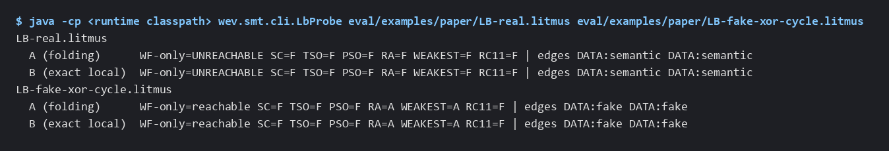
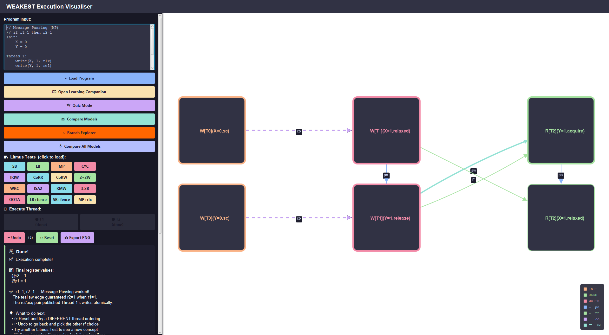
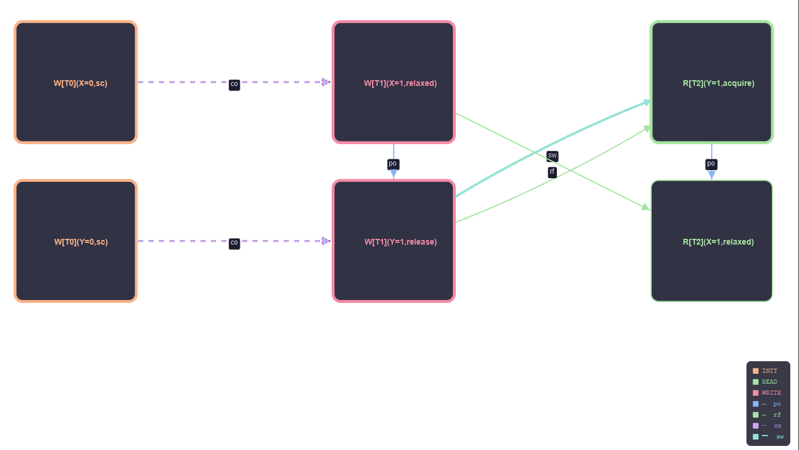
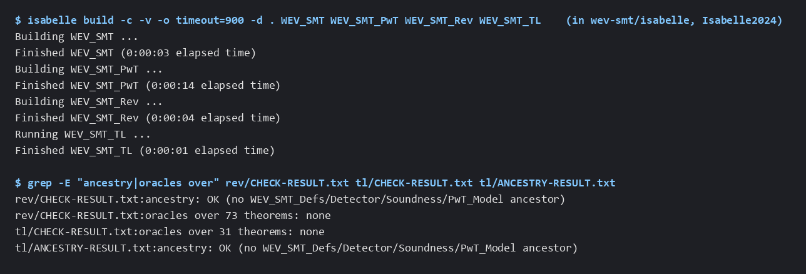
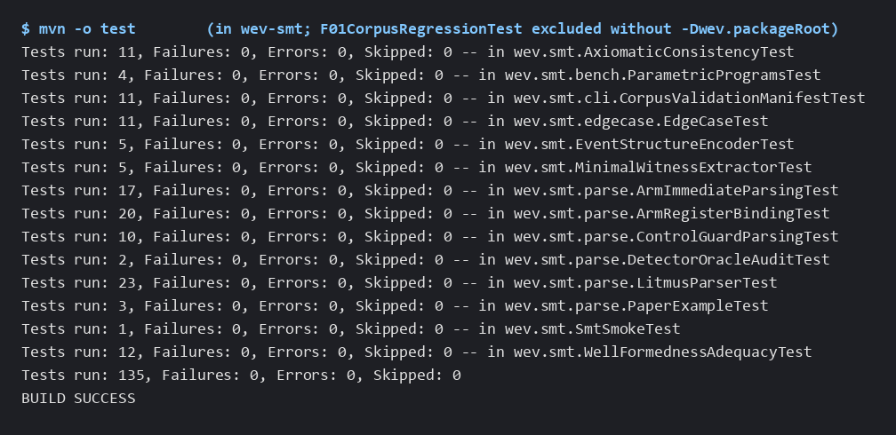

# WEV-SMT

WEV-SMT asks whether a small concurrent program can produce a given outcome under a weak memory model. It reads a litmus test, builds the candidate executions, and encodes their consistency for six models (SC, TSO, PSO, RA, WEAKEST, RC11) as SMT queries solved by Z3 through JavaSMT.

What makes it more than a consistency checker is its handling of dependencies. Some models only forbid a load-buffering outcome when a store really depends on an earlier load. Syntax alone cannot tell: `r + 1` depends on `r`, but `r ^ r ^ 1` is always 1. WEV-SMT asks a bitvector constancy oracle (QF_BV, 32-bit) whether a store's value expression can change when the loaded value changes, and keeps only the dependencies that can.

It is a research prototype. It is meant for people working on memory models, out-of-thin-air reasoning and dependency analysis, and for anyone checking the results of the two papers it supports.



*`LbProbe` on two load-buffering programs. With a real dependency (`LB-real`), every model forbids the outcome. With a fake one (`r^r^1`, `LB-fake-xor-cycle`), both dependency edges are classified as fake and WEAKEST and RA allow it. A and B are two ways of composing dependencies through local code; they agree here.*

## What is in this repository

| Path | What it is |
|---|---|
| `src/`, `pom.xml` | The WEAKEST execution visualiser, an earlier JavaFX teaching tool. Its model classes (`com.weakest.model`) are the event-structure library WEV-SMT builds on. |
| `wev-smt/src/` | The WEV-SMT implementation (Java 21): litmus parser, encoder, consistency axioms, constancy oracle, command-line drivers. |
| `wev-smt/isabelle/` | The Isabelle/HOL development. See [its README](wev-smt/isabelle/README.md). |
| `wev-smt/tools/refcheck/` | A Python reference checker for the composed-label dependency verdicts. See [its README](wev-smt/tools/refcheck/README.md). |
| `wev-smt/eval/examples/` | Example litmus inputs. See [its README](wev-smt/eval/examples/README.md). |
| `wev-smt/eval/`, `wev-smt/docs/`, `wev-smt/artifact/` | Earlier evaluation outputs, notes and a Docker reproduction package from the pre-TACAS development (see "Historical material" below). |
| `fsen2027-41/` | The FSEN 2027 submission (`paper.pdf`) and its supporting research archives, kept as submitted. See [its README](fsen2027-41/README.md). |

## Status of the implementation

The code in `wev-smt/src` is the **corrected-v1** implementation from the TACAS 2027 #4549 artifact, plus three drivers from the FSEN add-on archive (`ComposedLabelRun`, `LbProbe`, `MemhopWitness`).

After the TACAS submission, a defect was found in the encoder's well-formedness constraints (finding F-01): it rejected some candidate executions that no model forbids. The artifact's correction notice reports that 12 of 14,376 corpus verdicts were wrong (3 files, each under PSO, RA, WEAKEST and RC11), all FORBIDDEN where ALLOWED is correct. The corrected totals it gives (allowed / forbidden) are:

| | PSO | RA | WEAKEST | RC11 |
|---|---|---|---|---|
| submitted | 1,170 / 1,226 | 2,089 / 307 | 2,356 / 40 | 2,169 / 227 |
| corrected | 1,173 / 1,223 | 2,092 / 304 | 2,359 / 37 | 2,172 / 224 |

These numbers come from `CORRECTION-NOTICE.md` in the corrected-v1 base artifact. That archive (`tacas2027-4549-artifact-corrected-v1.zip`), which also holds the frozen corpus needed to rerun them, was removed from the current tree in commit `f7f41a0` because of its size. It can still be downloaded from an earlier commit (see "Getting the base artifact" below). The numbers were not recomputed for this README. The fix is in `EventStructureEncoder` and `MinimalWitnessExtractor`; `WellFormednessAdequacyTest` and `F01CorpusRegressionTest` cover it.

## What is proved and what is tested

**Proved in Isabelle/HOL** (all four sessions build with no `sorry` and no oracles; the theories are listed in the [Isabelle README](wev-smt/isabelle/README.md)):

- Lemma 2 (the dependency detector never drops a semantic dependency), detector exactness on branch-free code, and Theorem 1 (WEAKEST consistency rules out thin-air cycles). These are proved relative to stated assumptions about the oracle; `PwT_Model` shows the two oracle assumptions hold for the concrete 32-bit expression semantics.
- The PwT correspondence for the 32-bit expression language, and the FSEN revision results: version-aware closure, ring-weighted closure, block summaries, and exactness on the taint-linear fragment.

**Not proved:**

- The Java code is not verified. Nothing links the Isabelle definitions to the encoder mechanically. The encoder's adequacy and the well-formedness argument behind the F-01 fix are paper-level arguments backed by tests.
- Z3 is trusted. A "constant" verdict is only as good as the solver's unsat answer.
- The theorems cover data dependencies in branch-free straight-line code. Address dependencies are implemented but have no theorem; control dependencies are covered only on a small fragment, and the front end keeps every control edge.

**Tested:**

- 135 JUnit tests in `wev-smt` (parser, encoder, consistency axioms, the F-01 counterexample, edge cases, manifest handling), plus 5 F-01 corpus regressions that need the extracted base artifact.
- `AtlasReconstruct` compares the six models against expected verdicts on classic litmus shapes: 190 compared cells, 190 matched.
- The reference checker agrees with mode C on the add-on's diagnostic and regression inputs (44 of 44 dependency pairs). It shares Z3 with the prototype for "constant" verdicts, so this agreement is supporting evidence, not proof.

Limitations from the artifact that still apply: only branch-free, fixed-outcome queries with BV32 values are decided; known front-end defects are excluded rather than fixed; results were produced on Windows 11 x64 and the Linux route was tested under WSL2 only; runtimes come from one machine.

## Building and running

Requirements: JDK 21 and Maven 3.9. The Z3 natives for Windows x64 and Linux x64 are fetched from Maven Central by OS-activated profiles. The pom also has macOS profiles, but macOS is untested. Python 3.11 with `z3-solver` is only needed for the reference checker, and Isabelle2024 only for the proofs.

```
# 1. Install the visualiser's model classes (WEV-SMT depends on them)
mvn install -DskipTests

# 2. Build and test WEV-SMT
cd wev-smt
mvn test
```

The visualiser itself runs with `mvn javafx:run` from the repository root. The JavaFX Maven plugin needs network access the first time it runs. Alternatively, run the shaded jar that `mvn package` builds:

```
mvn package -DskipTests
java -jar target/weakest-visualiser.jar
```

### Getting the base artifact

The F-01 corpus regressions, the corpus reruns and the FSEN add-on's full driver all need the corrected-v1 base artifact. It is not in the current tree, but the copy committed in `7c4829e` is still served by GitHub:

https://github.com/vsvidhun06-blip/WEV-SMT/raw/7c4829e3a2c6c44becca5e1130aa7d638e2718ff/fsen2027-41/tacas2027-4549-artifact-corrected-v1.zip

It is 66,420,891 bytes, with SHA-256 `45e434df4825e2e7f47178d97109583b7300bea6b1562612c5562983359429af`. This matches `fsen2027-41/SHA256SUMS.txt` and the hash the add-on archive pins. Check it before use, then extract it outside the repository:

```
# PowerShell
Get-FileHash .\tacas2027-4549-artifact-corrected-v1.zip -Algorithm SHA256
# Linux
sha256sum tacas2027-4549-artifact-corrected-v1.zip
```

On Windows, extract to a short path; the archive's deepest files are long. Then, from `wev-smt`:

```
mvn test -Dwev.packageRoot=<extract dir>/tacas2027-4549-artifact-corrected-v1
```

Without that property, `F01CorpusRegressionTest` is excluded. With it, the test fails on any missing or hash-mismatched input instead of skipping. The archive's own `README.md` describes the remaining reproduction steps.

Command-line tools run through the exec plugin after `mvn test`, for example:

```
mvn -q exec:exec@atlas        # six-model atlas, CSVs in eval/
mvn -q exec:exec@ra-formal    # RA_FORMAL chain atlas
```

Other drivers in `wev.smt.cli` (`LbProbe`, `ComposedLabelRun`, `CorpusValidation` and more) run with plain `java` and the runtime classpath; `wev-smt/tools/refcheck/README.md` shows how to build it.

To check the proofs, from `wev-smt/isabelle`:

```
isabelle build -d . WEV_SMT WEV_SMT_PwT WEV_SMT_Rev WEV_SMT_TL
```

## Captured runs

### Execution visualiser

Window captures of the JavaFX visualiser (`src/`), run from `target/weakest-visualiser.jar` on 2026-11-14 on Windows 11 at 1920x1080. They are cropped but otherwise unedited. The visualiser has its own execution enumerator and consistency rules. It does not call WEV-SMT or Z3, so nothing in these images is solver output.



*The built-in MP (message passing) litmus test, stepped through by hand: Thread 1 writes X and then Y with release, and Thread 2 reads Y=1 with acquire and then X=1. The left panel shows the program, controls and final register values; the right panel shows the execution graph.*



*The graph pane from the same run, drawn by the visualiser, not by WEV-SMT. Initial writes (orange), writes (pink) and reads (green) are joined by po, rf, co and sw edges. The teal sw edge comes from the release/acquire pair on Y and runs alongside the rf edge between the same two events; their labels are offset so both show.*

These captures come from the visualiser after a presentation-only stylesheet change in `MainController.graphStyle()`: wider event boxes so labels fit, and separate label offsets for rf and sw edges. Events, edges and the checker are unchanged.

### WEV-SMT command line

These are renders of real terminal output from 2026-11-14 on Windows 11 (JDK 21.0.10, Maven 3.9.11, Isabelle2024). The text versions are next to the images in `docs/captures/`.



*Clean build of the four Isabelle sessions, then the oracle and ancestry check lines.*



*`mvn -o test` in `wev-smt`, per test class. The F-01 corpus regressions are excluded in this run; with the artifact root they pass too (140 tests).*

## Known issues

`CorpusValidationManifestTest.exhaustedBudgetYieldsTimeoutRowsForEveryEntryAndModel` failed once during validation on 2026-11-14 (expected `TIMEOUT`, got `UNSAT`). It then passed six isolated runs and a further full `mvn test`. The test runs with a zero time budget, so timing sensitivity is the suspected cause. That has not been confirmed, and the issue is not resolved.

### Visualiser checker issues

These concern the JavaFX visualiser's own checker (`src/main/java/com/weakest/ui/ExecutionEnumerator.java`), not WEV-SMT. They are not fixed. For each, "observed" is what the implementation does, checked by running it; "expected" is a claim about the standard models.

**MP in "Compare All Models".**
- Observed: for the built-in MP test (relaxed write to X, release write to Y; acquire read of Y, relaxed read of X), the view lists `r1=1, r2=0` as allowed under TSO, PSO, RA and WEAKEST. The visualiser's own step-by-step panel says the sw edge forbids it. In the code, `isTSOValid` only checks same-location coherence and store forwarding, and `isRAValid` only checks that an acquire read reads from a release write; neither relates the two locations.
- Expected: TSO and release/acquire both forbid `r1=1, r2=0` for this program.

**Model hierarchy banner.** The same view says "Each model ALLOWS everything the model to its left allows, plus more" for SC, TSO, PSO, RA and WEAKEST.
- Observed: for `write(X, 1, rlx)` in one thread and `@r1 = read(X, acq)` in another, the visualiser's enumerator gives `r1=0` and `r1=1` under SC, TSO, PSO and WEAKEST but only `r1=0` under RA, because its RA rule rejects an acquire read from a relaxed write. So the banner does not hold for the visualiser's own checker.
- Expected: PSO and RA are incomparable. PSO allows the MP outcome `r1=1, r2=0` because it can reorder the two stores, while RA forbids it when the flag is written with release and read with acquire; RA allows the IRIW weak outcome, which PSO, being multi-copy atomic, forbids. In standard C11-style semantics an acquire read may also read from a relaxed write (it just does not synchronise), so the RA rule above is itself stricter than usual.

## Historical material

`wev-smt/eval/`, `wev-smt/docs/` and `wev-smt/artifact/` were prepared for an earlier POPL artifact evaluation package, before the TACAS work, and are kept as they were. They describe that older build. In particular `artifact/reproduce.sh` expects 45 unit tests, and its atlas snapshot has no RC11 rows. It will not pass against the current code, although the 200 snapshot rows it does contain still match. Their claims refer to that build, not to the corrected implementation.

`fsen2027-41/README.md` still lists the base artifact archive among the four archives to use. That archive is no longer in the current tree; see "Getting the base artifact" for the historical download link.

## Papers

- *The Limits of Read-Restricted Dependency Summaries*, FSEN 2027 submission 41 (`fsen2027-41/paper.pdf`). Submitted; this repository does not record a decision.
- *The Limits of Instruction-Local Dependency Summaries, with an Application to Thin-Air Reads*, TACAS 2027 submission #4549. The corrected-v1 artifact is the source of the implementation here.

There is no licence file at the top level of this repository. The research archives carry their own licence and third-party notices.
